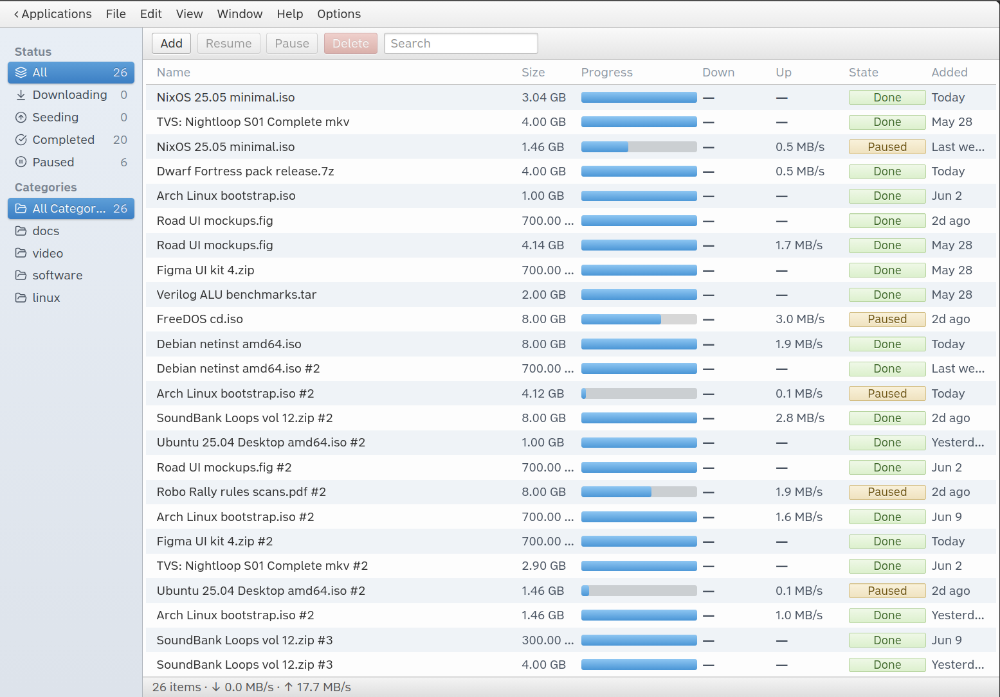
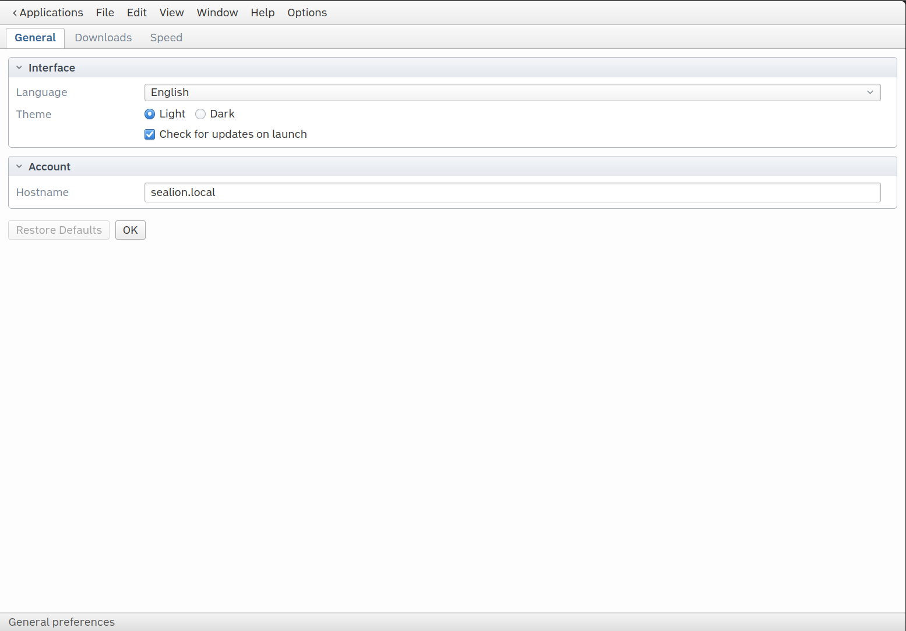

# sealion-ui
[Link to demo page](https://sealion.kitan.moe/)

UI Component Library for SolidJS, taking design inspiration from MacOS Mountain Lion.

<div align="center">





</div>

## Use

```sh
npm install github:needfish/sealion-ui
```

```jsx
import "@sealion/ui/sealion.css";
import { Tabs } from "@sealion/ui";
```

Peer dep: `solid-js` ^1.9. Icons come from `lucide-solid`.
